<picture>
  <source media="(prefers-color-scheme: dark)" srcset="./assets/hero-dark.svg" />
  <source media="(prefers-color-scheme: light)" srcset="./assets/hero-light.svg" />
  
</picture>

 

## 👋 Hi, I'm Jeff

I've spent 27 years in enterprise tech, and these days I build with AI agents: **multi-agent swarms** that split up and coordinate work, and **agentic memory systems** that let agents keep useful context across long-running tasks. I'm an AWS Certified Solutions Architect – Professional, based in Detroit.

## 🚀 What I'm building

- **[AgentQuanta](https://agentquanta.ai/)**: seven tools on one infinite canvas, made for the agentic era. It's local-first with zero cloud, speaks MCP and OpenTelemetry, and is built in Detroit. Pay once, own it forever.
- **[HedgeAgent](https://hedgeagent.ai/)**: an AI-powered virtual hedge fund where multi-persona trading agents work side by side, with real-time P&L and a live signal feed.

## 🎙️ Teaching

On YouTube I run **[AI in 5](https://www.youtube.com/@AIin5m)**, which explains how AI actually works in about five minutes per idea.

## 🛠️ What my agents and I work on

**Cloud** 

**Infrastructure & DevOps** 

**Languages & frameworks** 

**Auth, payments & email** 

**Data & AI** 

## 📜 Certifications

## 🌍 Open-source contributions

<!-- prs:start -->
- 🟣 **[bilawalsidhu/gods-eye-view](https://github.com/bilawalsidhu/gods-eye-view)**: [fix(firms): retry over IPv4 when every address fails to connect](https://github.com/bilawalsidhu/gods-eye-view/pull/1078) merged · Oct 2026
- 🟣 **[bilawalsidhu/gods-eye-view](https://github.com/bilawalsidhu/gods-eye-view)**: [feat(bikeshare): add Detroit, Pittsburgh, Aspen and Kona & Hilo](https://github.com/bilawalsidhu/gods-eye-view/pull/1082) merged · Oct 2026
- 🟡 **[bilawalsidhu/gods-eye-view](https://github.com/bilawalsidhu/gods-eye-view)**: [feat(border-waits): add a Border Wait Times layer from U.S. CBP](https://github.com/bilawalsidhu/gods-eye-view/pull/1107) in review · Oct 2026
<!-- prs:end -->

Updates automatically from GitHub.

## 🎬 Latest from AI in 5

<!-- videos:start -->
- ▶️ [Where the Memory Goes: Weights vs Activations](https://www.youtube.com/watch?v=RjZeLFD_gzk) Aug 2026
<!-- videos:end -->

Updates automatically from YouTube.
